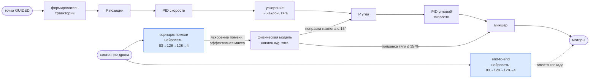

# Copter PID-RL

Нейросети в контуре управления квадрокоптера на ArduPilot: сравнение трёх подходов на
одинаковых испытаниях в Gazebo Harmonic + ArduPilot SITL.

| Подход | Что делает нейросеть | Обучение |
|---|---|---|
| **ArduPilot** (база) | — штатный каскад PID в режиме GUIDED | — |
| **Компенсатор возмущений** | оценивает ветер и изменение массы по поведению дрона; физическая модель переводит оценку в ограниченную поправку наклона и тяги внутри каскада ArduPilot | с учителем (PyBullet) |
| **End-to-end** | сама задаёт команды четырём моторам, без каскада | PPO (PyBullet) |

Прошивка с компенсатором: [VermennikovMV/ardupilot-ROSMeetUp](https://github.com/VermennikovMV/ardupilot-ROSMeetUp)
(ArduPilot 4.7.2 + библиотека `AC_ResidualPolicy`, параметры `RESID_*`).



## Результаты (Gazebo + SITL, штатный ArduPilot 4.7.2)

Одинаковые возмущения во всех сериях: порывы — внешняя сила на корпус по расписанию
(3 Н, три порыва по 3 с с разворотом направления), груз — 0,35 кг (20 % массы) на
отцепляемом звене, сброс на 12 с (висение) или 4 с (трасса). Трасса — квадрат 10×10 м:
две пролётные точки (радиус 0,5 м), остановка на 2 с посередине и финиш. 8 seed на
сценарий с ветром.

| Сценарий | ArduPilot | Компенсатор | End-to-end |
|---|---|---|---|
| Висение, порывы: RMSE / пик | 11,2 / 23,7 см | **3,6 / 10,5 см** (−68 % / −56 %) | 5,5 / 15,7 см (−51 % / −34 %) |
| Порывы + груз: RMSE | 10,5 см | **3,6 см** (−66 %) | 5,4 см (−49 %) |
| Сброс груза: скачок высоты | 6,5 см | 4,5 см (−31 %) | **3,5 см** (−46 %) |
| Трасса: время | 21,4–21,5 с | 21,4 с | **18,3–18,5 с** (−15 %) |
| Трасса с порывами: уход с линии RMS / пик | 14 / 47 см | **12 / 47 см** (−18 % по RMS) | 52 / 102 см |
| Пиковый наклон на трассе | 29° | 31° | 46° |
| Висение без возмущений | 0,5 см | 0,5 см | 1,4 см |
| Потеря управления | 0 | 0 | 0 |

- **Компенсатор** сохраняет траекторию и безопасность ArduPilot (поправка ограничена
  ±15° и ±15 % тяги, все контуры штатные) и в 3 раза лучше держит точку при ветре.
  Скорость трассы задаёт планировщик ArduPilot, компенсатор её не меняет.
- **End-to-end** на 15 % быстрее на трассе и в 2 раза лучше ArduPilot держит точку при ветре,
  но менее точен на линии, наклоняется сильнее и не имеет гарантий каскада.
- Оба переносятся из PyBullet (где обучены) в Gazebo + SITL без потери устойчивости.

Подробно: [docs/results.md](docs/results.md), метод: [docs/method.md](docs/method.md).

## Структура

```
configs/      конфигурации обучения и оценки, параметры стенда SITL
training/     PyBullet: модель Iris, копия каскада ArduPilot, обёртки, обучение, оценка
  environment.py   среда PyBullet (физика винтов, рандомизация, возмущения, трассы)
  pid.py           копия каскада ArduPilot (позиция → скорость → ускорение → угол → угловая скорость)
  guided_shaper.py формирователь цели GUIDED (AC_PosControl::input_pos_NED_m)
  wpnav.py         навигатор AUTO (AC_WPNav, S-кривые) — для сравнения режимов
  wrappers.py      награда, вход поправки, наблюдения, оценщик и компенсация
  stacks.py        готовые сборки сред: ardupilot / compensator / end_to_end
  estimator.py     сбор данных и обучение оценщика возмущений
  ppo.py           обучение end-to-end (PPO)
  evaluate.py      сравнение на одинаковых сценариях и seed
  tools.py         экспорт модели, изменение числа входов без потери обучения
controllers/  кодировщик наблюдений (общий для Python и прошивки)
experiments/  трасса, правила прохождения точек, расписания возмущений
gazebo/       испытания в Gazebo + SITL, плагин возмущений
demo/         демонстрации: три дрона в одной сцене (трасса, груз, ветер)
simulation/   запуск Gazebo + SITL, модель Iris, параметры стенда
models/       обученные модели
```

## Быстрый старт

```bash
python -m pip install -r requirements.txt

# сравнение в PyBullet на одинаковых сценариях и seed: ArduPilot (копия), компенсатор, end-to-end
python -m training.evaluate --estimator models/estimator.npz --policy models/e2e_policy.npz \
    --seeds 8 --out runs/pybullet.json
```

Gazebo + SITL (нужны Gazebo Harmonic, ardupilot_gazebo и собранный
[ardupilot-ROSMeetUp](https://github.com/VermennikovMV/ardupilot-ROSMeetUp), см. [docs/setup.md](docs/setup.md)):

```bash
python gazebo/evaluate_ardupilot.py --controller stock   --out runs/gazebo/stock     # RESID_ENABLE=0
python gazebo/evaluate_ardupilot.py --controller network --out runs/gazebo/network   # компенсатор в прошивке
python gazebo/evaluate_e2e.py --policy models/e2e_policy.npz --out runs/gazebo/e2e
python gazebo/compare.py runs/gazebo/stock runs/gazebo/network runs/gazebo/e2e
```

Отдельный случай: `--cases hover/gust --seeds 90000`.

Демонстрации (три дрона одновременно): `python demo/run.py race|payload|wind|final`, см. [demo/](demo/README.md).

## Воспроизведение обучения

Модели в `models/` получены ровно этими командами (время — на 32 потоках).

**Оценщик возмущений** (~20 мин). Летает штатный каскад ArduPilot (копия), в части полётов к его
командам добавлены случайные поправки; помеха в симуляторе известна точно — оценщик учится с учителем.

```bash
python -m training.estimator collect --out runs/estimator/data.npz
python -m training.estimator train runs/estimator/data.npz --out models/estimator.npz
```

**End-to-end** (~3,5 ч, 36 млн шагов). Одна команда; этапы обучения заданы в
[configs/e2e_curriculum.json](configs/e2e_curriculum.json): сначала короткие отрезки и обычная
награда (научиться летать), затем длинные трассы и старты в движении, затем награда за скорость.
Обучение детерминировано: та же команда даёт те же веса.

```bash
python -m training.ppo --out runs/e2e          # контрольные точки: runs/e2e/ckpt_*, итог: runs/e2e/policy.npz
python -m training.tools export-actor runs/e2e/ckpt_030464000 runs/e2e/policy_30m.npz   # любая контрольная точка
```

Этап «скорость» остановлен на 36 млн шагов: при дальнейшем обучении сеть летает агрессивнее
(наклон до 60°) и к 50 млн шагов начинает падать на трассе (3 аварии из 24 полётов).

Награда, входы и рандомизация описаны в [docs/method.md](docs/method.md).

## Свои модели

Все скрипты принимают путь к модели, поэтому новую модель можно проверить теми же командами.

| Модель | Формат `.npz` | Проверка |
|---|---|---|
| Оценщик | `W0, b0, W1, b1, …` (tanh между слоями), `y_mean`, `y_std`; вход 83, выход 4 | `training.evaluate --estimator`; в прошивке — 83 → 128 → 128 → 4 |
| End-to-end | `w0, b0, w1, b1, …` (tanh между слоями, выход ограничен ±1); вход 83, выход 4 мотора | `training.evaluate --policy`, `gazebo/evaluate_e2e.py --policy` |

- Другой размер сети: `training.estimator train … --hidden 256 256`, `training.ppo … --net 256 256`.
- Другие награда, этапы или рандомизация: `training.ppo --reward '{"route_time": 0.6}'`,
  `--curriculum my_stages.json`, `--config my_config.json` (формат — как в `configs/`).
- Продолжить обучение: `training.ppo --out runs/e2e_more --resume runs/e2e/ckpt_035840000 --steps 45000000`.
- Добавить входы без потери обучения: `python -m training.tools widen` (новые входы получают нулевые веса).
- Веса оценщика встраиваются в прошивку генерацией `estimator_weights.h` в
  [ardupilot-ROSMeetUp](https://github.com/VermennikovMV/ardupilot-ROSMeetUp) (`libraries/AC_ResidualPolicy`).

## Ограничения

- Модели обучены для квадрокоптера класса Iris (рама ~550 мм, винты 10″, ~1,75 кг) с
  рандомизацией вокруг него; для другого класса нужно повторить обучение.
- Компенсатор распознаёт помехи, заложенные в обучение (горизонтальные силы, изменение
  массы и тяги моторов). Другие помехи он не компенсирует; безопасность при этом
  обеспечивают ограничение поправки и штатный каскад.
- Проверка — в симуляторах (PyBullet → Gazebo + SITL); на реальном аппарате не проверялось.

## Лицензия

[MIT](LICENSE). Модель Iris в `simulation/models/iris` и внешние компоненты — см.
[THIRD_PARTY_NOTICES.md](THIRD_PARTY_NOTICES.md).
