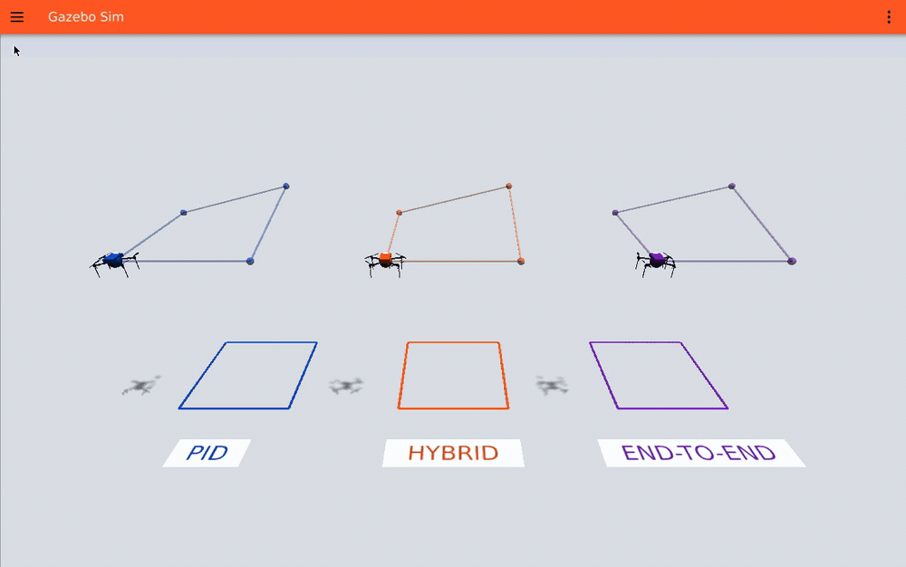

# Copter PID/RL

Сравнение PID, гибридного PPO и прямого нейросетевого управления квадрокоптером. Три Iris одновременно летают в **Gazebo с ArduPilot SITL**: проходят маршрут с поворотами и удерживают позицию при порывах ветра.



GIF показывает прохождение маршрута (16 с записи). MP4 содержит весь 40-секундный измерительный участок.

[Видео маршрута в исходном разрешении](assets/gazebo/route.mp4) · [Запуск из терминала](assets/gazebo/terminal_route.mp4)

| Дрон | Контроллер | Команды во время сравнения |
|---|---|---|
| Синий — **PID** | Каскад ArduPilot | Целевая позиция → штатные PID-контуры |
| Оранжевый — **Hybrid** | PPO и внутренний PID | Сеть задаёт тягу и угловые скорости; PID стабилизирует вращение |
| Фиолетовый — **End-to-end** | Direct111 | Сеть напрямую задаёт четыре моторные команды |

Сети получают численные измерения состояния, а не изображение камеры. Взлёт и посадка у всех выполняются штатным автопилотом; сравнение начинается после стабилизации в первой точке. [Подробности архитектуры](reference_manual/architecture.md).

## Одинаковые условия

Модель, масса **1,75 кг**, моторы, настройки автопилота и нагрузка одинаковы. Дополнительного груза в этих двух демонстрациях нет. Трассы одинаковой формы смещены на 4 м друг от друга, чтобы дроны не сталкивались. Каждый стартует из своей первой точки после общей проверки положения и скорости.

Ветер моделируется внешней силой в ньютонах. Один плагин прикладывает одинаковый вектор ко всем трём дронам в один такт физики. Отсчёт времени общий, заданная частота команд контроллеров — 50 Гц. Фактические силы, параметры моделей, команды и измерения сохраняются для проверки.

## Удержание при порывах


[Видео удержания](assets/gazebo/hover.mp4) · [Метрики этих полётов и проверка условий](results/shared_world/README.md)

GIF получены из записи окна Gazebo. Скорость воспроизведения — 1× реального времени записи. Численные результаты считаются по времени симулятора.

## Запуск

[Установка Gazebo, SITL и зависимостей](docs/gazebo_setup.md). Проверенная конфигурация — Windows / WSL2: Ubuntu 22.04 для Gazebo и Ubuntu 24.04 для контроллеров.

```bash
git clone https://github.com/VermennikovMV/Copter_PID-RL.git
cd Copter_PID-RL

# Маршрут под постоянной ветровой нагрузкой
python3 -m demo_three.present route

# Удержание позиции при порывах
python3 -m demo_three.present hover
```

Команды выполняются в Ubuntu 22.04 после установки стенда. Открывается окно Gazebo, запускаются три экземпляра SITL и запись экрана. Видео, телеметрия и параметры опыта сохраняются в `runs/`. Порядок проверки и создания GIF приведён в инструкции установки.

## Результаты и применимость

[Таблица совместных полётов](results/shared_world/README.md) относится ровно к двум показанным опытам. По одному запуску нельзя установить универсальное преимущество контроллера.

| Измерение | PID | Hybrid | End-to-end |
|---|---:|---:|---:|
| Маршрут: время, с ↓ | 9,460 | **8,399** | 11,298 |
| Маршрут: RMSE активного отрезка, м ↓ | 0,1442 | **0,0893** | 0,2126 |
| Порывы: RMSE удержания, м ↓ | 0,1066 | **0,0553** | 0,0763 |

Все три завершили оба опыта без срыва. PID лучше удерживал курс; остальные метрики, параметры ветра и ограничения сравнения приведены в полной таблице.

Более широкие проверки вынесены в [карту применимости и описание метрик](reference_manual/metrics.md). Для гибрида v29 пройдены 8 из 8 основных условий Gazebo; две дополнительные проверки точности остались не пройдены. [Таблица v29](results/phase29_v8/applicability.csv). Исторические серии и разные версии сетей сохранены отдельно.

Сети обучались в PyBullet, перенос проверялся в Gazebo. [Обучение и происхождение весов](reference_manual/reproduction.md) · [Выбор PPO и альтернативы](results/algorithm_choice/choice.pdf).

## Структура

```text
demo_three/       совместный запуск, ветер, запись экрана и аудит
models/           выбранные сети и контракт их входов/выходов
v2/               контроллеры и исследовательский код
assets/gazebo/    записи окна Gazebo и GIF
results/          измерения, таблицы и история экспериментов
reference_manual/ архитектура, метрики и воспроизведение
docs/             установка и протоколы
```

[Руководство](reference_manual/README.md) · [Модели](MODEL_CARD.md) · [Проверки CI](https://github.com/VermennikovMV/Copter_PID-RL/actions) · [Лицензии](LICENSE_STATUS.md)

