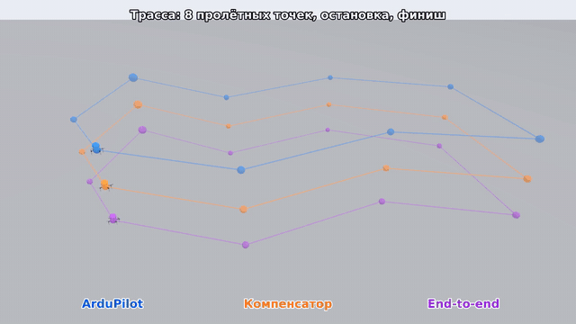
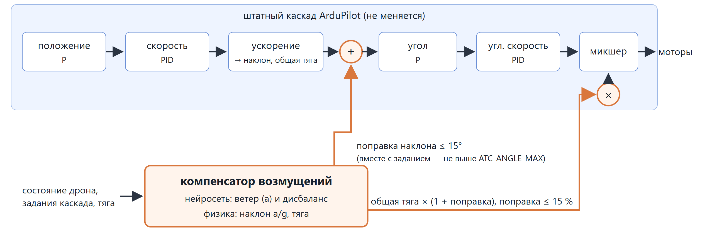
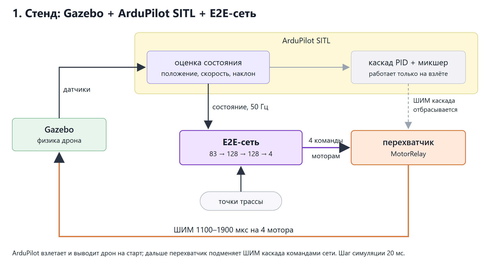
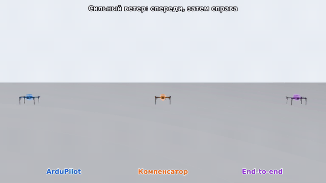
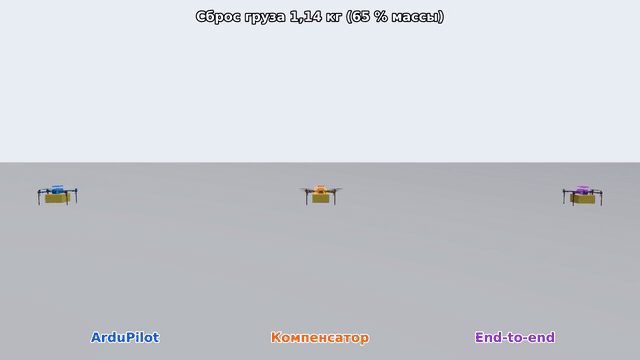
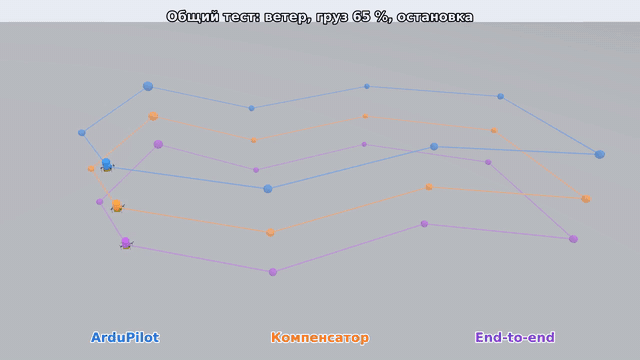

# Copter PID-RL

Нейросети в контуре управления квадрокоптера на ArduPilot. Три подхода на одинаковых
испытаниях в Gazebo Harmonic + ArduPilot SITL: штатный каскад PID, тот же каскад с
обучаемым компенсатором возмущений и end-to-end нейросеть, которая сама управляет моторами.

<p align="center">
  <br>
  <sub>Одна трасса, одни условия: <b>синий</b> — ArduPilot, <b>оранжевый</b> — ArduPilot + компенсатор,
  <b>фиолетовый</b> — end-to-end. Дроны идут один над другим через 2 м.</sub>
</p>

| | Что делает нейросеть | Обучение |
|---|---|---|
| **ArduPilot** | — (штатный каскад; висение — GUIDED, трасса — миссия AUTO) | — |
| **Компенсатор возмущений** | оценивает ветер и вертикальный дисбаланс (груз, моторы); физическая формула переводит оценку в ограниченную поправку наклона и тяги внутри каскада | с учителем, PyBullet, ~20 мин |
| **End-to-end** | выдаёт команды четырём моторам вместо каскада | PPO, PyBullet, ~3,5 ч |

Компенсатор работает внутри прошивки:
[**ardupilot-ROSMeetUp**](https://github.com/VermennikovMV/ardupilot-ROSMeetUp) —
ArduPilot 4.7.2 + библиотека `AC_DisturbanceCompensator`, включается параметром `RESID_ENABLE`.

## Как это устроено

**Компенсатор.** Каскад ArduPilot не меняется. Нейросеть-оценщик (MLP 83 → 128 → 128 → 3)
по поведению дрона оценивает ускорение от внешней силы и вертикальный дисбаланс. Поправка
считается физически: наклон навстречу силе на a/g, тяга −a_z/g. Поправка наклона входит
перед регулятором угла (там только P, интегратор её не «съедает»), поправка тяги — множителем
перед микшером.

<p align="center"></p>

Безопасность в прошивке: поправка ограничена параметрами `RESID_ANG_MAX` / `RESID_THR_MAX`
(по умолчанию 15° и 15 %), вместе с заданием не выводит наклон за `ATC_ANGLE_MAX`, обнуляется,
если её не обновляли 100 мс, и работает только в режимах AUTO, GUIDED, LOITER, RTL.

**End-to-end.** Актёр PPO (MLP 83 → 128 → 128 → 4) получает состояние дрона и ближайшие точки
трассы и выдаёт команды моторам. В стенде он подключён через перехватчик между SITL и Gazebo:
ArduPilot оценивает состояние, а команды моторам каскада подменяются командами сети. На
реальном дроне сеть стояла бы вместо каскада и микшера, а оценка состояния и режимы оставались
бы за ArduPilot.

<p align="center"></p>

## Результаты

Gazebo + ArduPilot SITL, 8 полётов на сценарий с ветром. Порывы — сила 3 Н на корпус по
расписанию, груз — 20 % массы, трасса — миссия AUTO со штатными ограничениями.

| Сценарий | ArduPilot | Компенсатор | End-to-end |
|---|---|---|---|
| Висение, порывы: RMSE / пик | 11,2 / 23,8 см | **3,7 / 10,9 см** | 5,5 / 15,7 см |
| Порывы + груз: RMSE | 10,5 см | **3,6 см** | 5,4 см |
| Сброс груза: скачок высоты | 6,5 см | 5,5 см | **3,5 см** |
| Трасса с порывами: время | 26,3 с | 25,9 с | **18,3 с** |
| Трасса с порывами: уход с линии (RMS) | 13 см | **10 см** | 52 см |
| Пиковый наклон на трассе | 21° | 24° | 46° |
| Потеря управления | 0 | 0 | 0 |

- **Компенсатор** в 3 раза лучше держит точку при порывах и сохраняет всё поведение
  ArduPilot: каскад штатный, поправка ограничена, выключается одним параметром.
  Время трассы задаёт планировщик ArduPilot, компенсатор его не меняет.
- **End-to-end** быстрее на трассе, но уходит с линии на полметра и наклоняется до 46°.
  Со спортивными ограничениями AUTO ArduPilot почти догоняет его по времени, а если
  точки нужно проходить точно, end-to-end теряет и в скорости ([demo/](demo/README.md)).
- Оценщик правильно оценивает и силы больше, чем были в обучении (5 и 7 Н при обученных
  до 4 Н); предел поправки можно поднять параметром ([docs/results.md](docs/results.md#сила-сильнее-чем-в-обучении-и-предел-поправки)).

Подробно: [docs/results.md](docs/results.md) · метод: [docs/method.md](docs/method.md).

## Демонстрации

Три дрона в одной сцене Gazebo, одинаковые ветер и груз в один и тот же шаг симуляции.

<table>
  <tr>
    <td align="center"><br><sub>Ветер спереди, затем справа (×3)</sub></td>
    <td align="center"><br><sub>Сброс груза 65 % массы</sub></td>
  </tr>
  <tr>
    <td align="center" colspan="2"><br><sub>Общий тест: трасса, порывы, сброс груза, остановка (×2)</sub></td>
  </tr>
</table>

```bash
python demo/run.py race | payload | wind | final      # окно Gazebo; --record out.mp4 — видео
```

Сцены, параметры и проверка объективности — в [demo/README.md](demo/README.md).

## Быстрый старт

```bash
python -m pip install -r requirements.txt

# PyBullet: ArduPilot (копия каскада), компенсатор и end-to-end на одинаковых сценариях
python -m training.evaluate --estimator models/estimator.npz --policy models/e2e_policy.npz \
    --seeds 8 --out runs/pybullet.json
```

Gazebo + SITL (нужны Gazebo Harmonic, `ardupilot_gazebo` и собранный
[ardupilot-ROSMeetUp](https://github.com/VermennikovMV/ardupilot-ROSMeetUp), см. [docs/setup.md](docs/setup.md)):

```bash
python gazebo/evaluate_ardupilot.py --controller stock   --out runs/gazebo/stock     # RESID_ENABLE=0
python gazebo/evaluate_ardupilot.py --controller network --out runs/gazebo/network   # компенсатор в прошивке
python gazebo/evaluate_e2e.py --policy models/e2e_policy.npz --out runs/gazebo/e2e
python gazebo/compare.py runs/gazebo/stock runs/gazebo/network runs/gazebo/e2e
```

Трасса миссией AUTO: `--mode auto --cases route/nominal,route/gust,route/joint`.

## Обучение

Модели в `models/` получены ровно этими командами (время — на 32 потоках).

**Оценщик возмущений** (~20 мин). Летает копия каскада ArduPilot, в части полётов к его
командам добавлены случайные поправки; сила и груз в симуляторе известны точно — это метки.

```bash
python -m training.estimator collect --out runs/estimator/data.npz
python -m training.estimator train runs/estimator/data.npz --out models/estimator.npz
```

**End-to-end** (~3,5 ч, 36 млн шагов). Этапы заданы в
[configs/e2e_curriculum.json](configs/e2e_curriculum.json): сначала научиться летать
(короткие отрезки, награда за каждый шаг), затем длинные трассы и старты в движении, затем
награда за скорость. Обучение детерминировано: та же команда даёт те же веса.

```bash
python -m training.ppo --out runs/e2e          # контрольные точки runs/e2e/ckpt_*, итог runs/e2e/policy.npz
```

Этап «скорость» остановлен на 36 млн шагов: дальше сеть летает агрессивнее (наклон до 60°) и
к 50 млн шагов начинает падать на трассе.

<details>
<summary><b>Свои модели</b></summary>

Все скрипты принимают путь к модели, поэтому новую модель можно проверить теми же командами.

| Модель | Формат `.npz` | Проверка |
|---|---|---|
| Оценщик | `W0, b0, W1, b1, …` (tanh между слоями, выход линейный), `y_mean`, `y_std`; вход 83, выход 3 | `training.evaluate --estimator` |
| End-to-end | `w0, b0, w1, b1, …` (tanh между слоями, выход ограничен ±1); вход 83, выход 4 мотора | `training.evaluate --policy`, `gazebo/evaluate_e2e.py --policy` |

- Другой размер сети: `training.estimator train … --hidden 256 256`, `training.ppo … --net 256 256`.
- Другие награда, этапы или рандомизация: `training.ppo --reward '{"route_time": 0.6}'`,
  `--curriculum my_stages.json`, `--config my_config.json` (формат — как в `configs/`).
- Продолжить обучение: `training.ppo --out runs/e2e_more --resume runs/e2e/ckpt_035840000 --steps 45000000`.
- Любую контрольную точку в модель: `python -m training.tools export-actor runs/e2e/ckpt_030464000 out.npz`.
- Добавить входы без потери обучения: `python -m training.tools widen` (новые входы получают нулевые веса).
- Веса оценщика встраиваются в прошивку генерацией `estimator_weights.h` в
  [ardupilot-ROSMeetUp](https://github.com/VermennikovMV/ardupilot-ROSMeetUp) (`libraries/AC_DisturbanceCompensator`).

</details>

## Структура

```
training/     PyBullet: модель Iris, копия каскада ArduPilot, оценщик, PPO, оценка
gazebo/       испытания в Gazebo + SITL, плагин возмущений, проверки прошивки
demo/         три дрона в одной сцене: трасса, груз, ветер, общий тест
simulation/   запуск Gazebo + SITL, модель Iris, параметры стенда
controllers/  кодировщик наблюдений (общий для Python и прошивки)
experiments/  трасса, правила прохождения точек, расписания возмущений
configs/      конфигурации обучения и оценки
models/       обученные модели
docs/         метод, результаты, установка
```

## Ограничения

- Модели обучены для квадрокоптера класса Iris (рама ~550 мм, ~1,75 кг) с рандомизацией
  вокруг него; для другого аппарата оценщик нужно переобучить теми же командами.
- Компенсатор распознаёт помехи, заложенные в обучение: горизонтальные силы, изменение массы
  и тяги моторов. При других помехах безопасность обеспечивают предел поправки и штатный каскад.
- Проверка — в симуляторах (PyBullet → Gazebo + SITL) с идеальной навигацией; на реальном
  аппарате не проверялось.

## Лицензия

[MIT](LICENSE). Модель Iris в `simulation/models/iris` и внешние компоненты — см.
[THIRD_PARTY_NOTICES.md](THIRD_PARTY_NOTICES.md).
