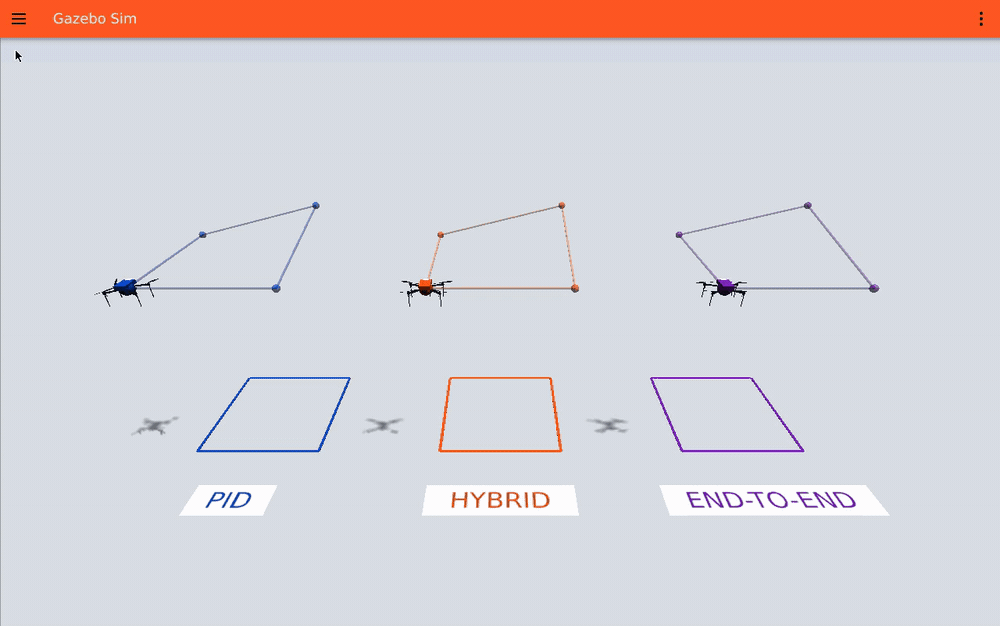

# Copter PID/RL

Сравнение трёх способов управления квадрокоптером: PID, Hybrid и End-to-end RL. Стенд работает в Gazebo с ArduPilot SITL. Нейросети обучаются методом PPO в PyBullet.

## Прохождение маршрута


Синий дрон — **PID**, оранжевый — **Hybrid**, фиолетовый — **End-to-end**. Каждый проходит один и тот же маршрут в своей полосе.

[Полная запись полёта](assets/gazebo/route_wp040.mp4) · [Запуск из терминала](assets/gazebo/terminal_wp040.mp4)

## Удержание позиции при ветре



Возмущение прикладывается одновременно ко всем трём дронам. Модель, масса, нагрузка и начальные условия одинаковы.

[Полная запись полёта](assets/gazebo/hover.mp4)

Оба GIF сделаны из записи окна Gazebo и воспроизводятся без ускорения.

## Контроллеры

| Контроллер | Как управляет дроном |
|---|---|
| **PID** | Штатные контуры ArduPilot отслеживают заданную позицию. |
| **Hybrid** | Сеть задаёт тягу и угловые скорости, внутренний PID управляет моторами. |
| **End-to-end** | Сеть непосредственно выдаёт четыре моторные команды. |

На вход сетей поступают положение, скорость, ориентация и история измерений. Взлёт выполняет штатный автопилот; сравнение начинается после стабилизации всех трёх дронов.

На видео используются модели с разной историей обучения. [Описание весов и обучения](docs/training_comparison.md).

## Запуск симуляции

Сначала установите зависимости по [инструкции](docs/gazebo_setup.md). Проверенный стенд использует Windows / WSL2: Ubuntu 22.04 для Gazebo и Ubuntu 24.04 для SITL и контроллеров.

```bash
git clone https://github.com/VermennikovMV/Copter_PID-RL.git
cd Copter_PID-RL

# Прохождение маршрута
python3 -m demo_three.present route --wp-radius 0.40

# Удержание позиции при ветре
python3 -m demo_three.present hover
```

Команды выполняются в Ubuntu 22.04. Открывается Gazebo с тремя дронами и начинается запись окна. Видео и журналы полётов сохраняются в `runs/`.

Для записи своей демонстрации добавьте `--manual-start`: дроны дождутся команды начала опыта. Порядок запуска и параметры приведены в инструкции установки.

## Структура проекта

```text
demo_three/        запуск трёх дронов, ветер и запись Gazebo
models/            веса нейросетей
v2/                контроллеры, обучение и код экспериментов
assets/gazebo/     записи полётов и GIF
results/           измерения и журналы проверок
docs/              установка и описание экспериментов
reference_manual/  техническое руководство
```

## Документация

- [Архитектура управления](reference_manual/architecture.md)
- [Обучение и воспроизведение](reference_manual/reproduction.md)
- [Метрики и результаты испытаний](reference_manual/metrics.md)
- [Описание опубликованных моделей](MODEL_CARD.md)
- [Лицензии компонентов](LICENSE_STATUS.md)
