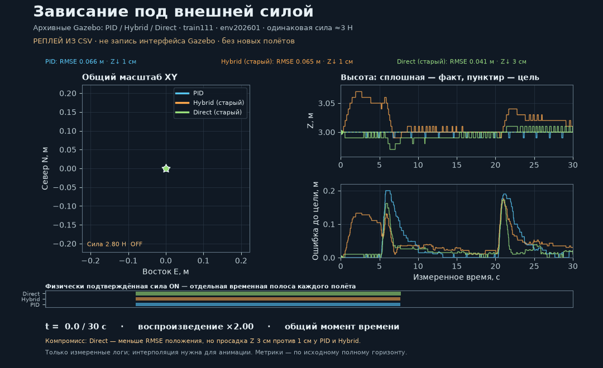
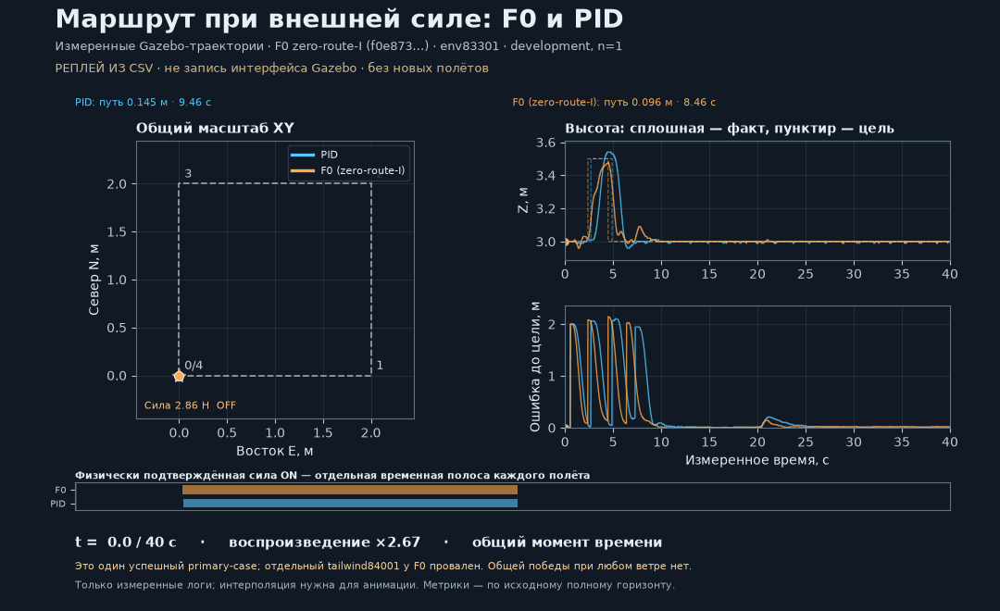

# Measured Gazebo trajectory replays

These GIFs animate actual saved telemetry CSVs. They are **not Gazebo GUI screen recordings**, generated simulator flights, or new evaluations. The first clip is the archived legacy train111/env202601 comparison; the second is actual F0 zero-route-I / PID env83301. They are different model generations and are not pooled.

## legacy_hover_3way

Компромисс: Direct — меньше RMSE положения, но просадка Z 3 см против 1 см у PID и Hybrid.

## f0_strong_route

Это один успешный primary-case; отдельный tailwind84001 у F0 провален. Общей победы при любом ветре нет.

Each clip is151 frames at10fps, with an explicit measured-time cursor and playback rate. XY/Z axes and measurement time are shared across methods. Force strips use each flight's independently verified physical ON/OFF timestamps. Position interpolation affects pictures only; displayed metrics come from original full-horizon summaries/audits. Route targets change according to each recorded controller's actual mission progress. No force is converted to wind velocity.

The complete source paths, source policy hashes, dependency SHA256, metric definitions, frame counts and limitations are in [manifest.json](manifest.json). Reproduce from the repository root with `python -B scripts/render_project_replay_gifs_v1.py` into a fresh output namespace (existing files are preserved).
