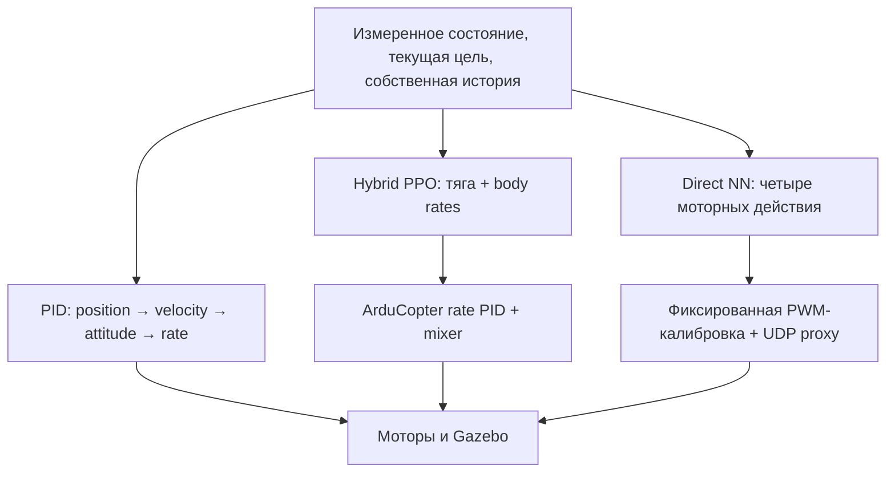

# Три управляющих интерфейса

| Режим | Что формирует команды | Что поступает в физику Gazebo |
|---|---|---|
| PID | Штатные position/velocity/attitude/rate контуры ArduCopter | Штатные моторные PWM |
| Hybrid | PPO-сеть: общая тяга и три угловые скорости | Rate PID и mixer ArduCopter распределяют тягу по моторам |
| Direct / end-to-end | Сеть: четыре моторных действия; фиксированная калибровка в PWM | UDP-прокси заменяет первые четыре PWM на измерительном участке |

Direct реализован и проверен в 108 исторических Gazebo-полётах: три семени
обучения и три семени среды. SITL продолжает вычислять PID, но его PWM на
измерительном участке Direct заменяются. Взлёт и посадка штатные. Регулятор
скорости мотора Gazebo моделирует привод, а не полётный стабилизатор.

F0/v20 использует 80 измеряемых признаков и сохраняет все шесть массивов весов
source68 побайтно. Нового обучения для F0 не было: только входы интеграла 22:25
обнуляются при наличии отрезка из действительно наблюдавшихся целей. Будущие
точки, истинный ветер и скрытые параметры физики сети недоступны.

V29 использует один общий причинный кодировщик и двух экспертов: F0 для удержания
позиции и реально дообученную PPO-сеть v28 для маршрута. Выбор зависит от текущего
валидного отрезка в собственной истории целей; на отсчёт вызывается одна сеть.
Предыдущая команда — фактически выданная команда выбранного эксперта. Сборка
переключателя не добавляла шагов обучения. Проверены 29 новых эпизодов PyBullet
и отдельная Gazebo-матрица: 9 новых полётов плюс 11 общих контрольных измерений.
Полное научное принятие не достигнуто: ограничения указаны в [метриках](metrics.md).

Переносимый CPU-экспорт имеет отдельный контракт
`public-shared-phase-expert-inference-v1.0`. Его четыре численных метода
унаследованы без изменений, полный причинный replay из 2000 отсчётов совпал точно.
Original ZIP остаётся только записью происхождения: он не включён и не объявлен
локально проверенным. Это не замена строгого исследовательского wire-контракта.
Direct CPU API возвращает нормированные действия и доли моторов, а не PWM.
`pid-fast` — аналитический эталон быстрого стенда, не эмуляция полётного PID SITL.

[Direct interface](../docs/historical_direct_interface.md) ·
[Точные модели и контракты](../MODEL_CARD.md) ·
[Исследовательский Gazebo-v8 код](../source_archive/phase29_gazebo)
