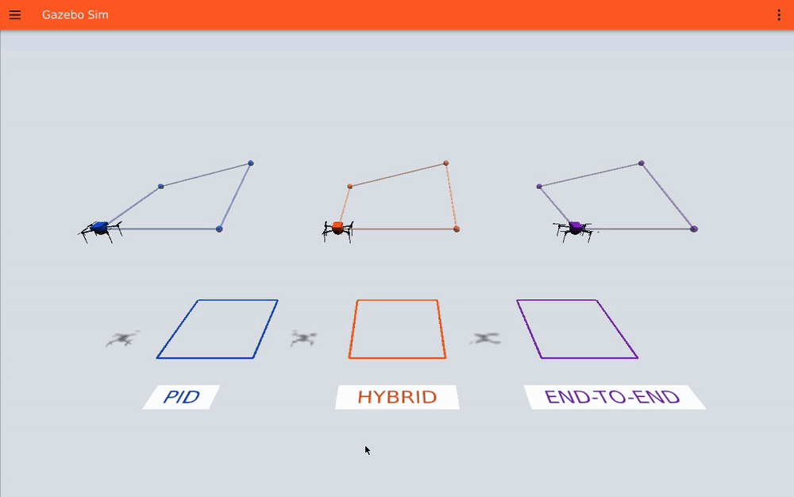

# Радиус достижения точки: 25 и 40 см

При допуске **40 см End-to-end завершил маршрут быстрее PID**: 8,222 против 9,162 с. Hybrid завершил за 7,861 с. При исходных 25 см End-to-end требовалось 11,318 с. Это два реальных запуска трёх дронов в Gazebo с неизменными весами сетей, по одному запуску на допуск. Нового обучения не было.

[Видео 40 см](../../assets/gazebo/route_wp040.mp4) · [GIF 25 см](../../assets/gazebo/route_wp025.gif) · [Видео 25 см](../../assets/gazebo/route_wp025.mp4) · [Реальная команда запуска](../../assets/gazebo/terminal_wp040.mp4)

GIF показывает полёт до завершения последним дроном плюс 2 с симуляции. Каждый MP4 содержит весь 40-секундный измерительный участок; скорость — 1× времени записи. Изображения получены захватом окна Gazebo, без восстановления траектории по координатам.

## Что менялось

Единственная запланированная переменная — радиус достижения точки: 0,25 → 0,40 м, одновременно для всех контроллеров. Удержание внутри радиуса — 0,5 с; разрыв измерений более 30 мс сбрасывает подтверждение. Это параметр `--wp-radius` менеджера миссии, не настройка навигации ArduPilot.

Порядок запусков и метрики записаны в [плане опыта](../../docs/waypoint_radius_sensitivity_v1.json). Масса 1,75 кг, без дополнительного груза; одинаковые модели, начальная точка в каждой полосе, маршрут, PID, веса сетей, сценарий `force_strong`, seed 83301 и горизонт 40 с. Полосы смещены на 4 м. Ветер — внешняя сила **2,856 Н**, вектор ENU `[2.61331048, −1.15216440, 0]`, примерно с 4,9 до 20,2 с; общий плагин прикладывает её ко всем трём в один такт физики.

Радиус 40 см ослабляет требование к точности прибытия. Этот опыт не заменяет исходный протокол 25 см и не исправляет задним числом его результаты. При изменении момента переключения точки меняются дальнейшая траектория и участок пути, на котором действует ветер.

## Измерения

Время считается от общего начала измерений до подтверждения последней точки, включая начальное удержание. RMSE и максимум отрезка — расстояние до конечного активного отрезка пути на всём прохождении; курс — RMSE за 40 с. Внутри каждого запуска условия одинаковы для трёх систем.

| Допуск | Контроллер | Завершил | Время, с ↓ | RMSE отрезка, м ↓ | Максимум, м ↓ | RMSE курса, ° ↓ |
|---|---|---|---:|---:|---:|---:|
| 25 см | PID | Да | 9,460 | 0,1443 | 0,3409 | 0,3834 |
| 25 см | Hybrid | Да | 8,418 | 0,0885 | 0,2177 | 0,7542 |
| 25 см | End-to-end | Да | 11,318 | 0,2117 | 0,3702 | 0,8317 |
| 40 см | PID | Да | 9,162 | 0,1554 | 0,3599 | 0,3787 |
| 40 см | Hybrid | Да | 7,861 | 0,1012 | 0,2188 | 0,7601 |
| 40 см | End-to-end | Да | 8,222 | 0,1622 | 0,3211 | 0,6777 |

Все завершили маршрут без отказов. Увеличение допуска уменьшило время End-to-end на 3,096 с; в новом опыте он быстрее PID на 0,940 с, но медленнее Hybrid на 0,361 с. Hybrid показал наименьшую ошибку отрезка при обоих допусках. Это наблюдения отдельных полётов, не статистическая оценка превосходства.

Оставшиеся исходные метрики приведены ниже. Ошибка цели включает движение к переключаемой точке. `DOWN` — максимум отклонения вниз от текущей цели: здесь есть заданный подъём цели на 0,5 м, поэтому это число нельзя целиком называть просадкой от ветра. Восстановление после порыва для маршрутного опыта не рассчитывается.

| Допуск | Метрика | PID | Hybrid | End-to-end |
|---|---|---:|---:|---:|
| 25 см | RMSE цели, м | 0,6592 | 0,5684 | 0,5902 |
| 25 см | DOWN, м | 0,495 | 0,545 | 0,515 |
| 40 см | RMSE цели, м | 0,6592 | 0,5696 | 0,5987 |
| 40 см | DOWN, м | 0,485 | 0,535 | 0,505 |

## Почему End-to-end задерживался

При 25 см он впервые вошёл в область точки с индексом 2 на 3,820 с, но вышел на 4,218 с, не выдержав 0,5 с. Максимальное отклонение достигло 0,370 м. После повторного входа точка была подтверждена на 6,840 с. Это произошло и в исходном видео, и в новом контрольном запуске; первый выход случился ещё до включения ветра.

При 40 см та же точка подтвердилась на 4,282 с. Переключение цели сработало раньше, и длительного ожидания на этом повороте не возникло. Следующая точка в старом опыте не была потеряна: условие её выдачи ещё не выполнилось.

## Проверка условий и ограничения

В опыте 25 см получено по 2000 команд на дрон без пропусков. В опыте 40 см — по 1996: четыре общих пропуска слотов, максимальный разрыв 40 мс. Они сохранены в данных; подтверждение первой точки у всех сдвинулось с 0,500 до 0,700 с. Средняя фактическая частота второго запуска — 49,9 Гц. Разрывы не скрывались и правило удержания не ослаблялось. Поэтому разность времени между двумя запусками не следует считать точной изолированной оценкой эффекта радиуса.

Фактическое включение/выключение силы по часам наблюдателя: 4,926/20,240 с при 25 см и 4,948/20,238 с при 40 см. Между запусками есть задержка доставки 22 мс при включении и 2 мс при выключении; внутри каждого запуска переключение произошло одновременно у всех трёх дронов.

Независимый аудит сверил записанные аргументы отправки команд, выход моторного прокси, массы, общий старт, фактическую силу и переходы миссии; все команды нейросетей воспроизведены без расхождений. Сетевой захват PCAP сохранён, но этим аудитом отдельно не декодировался. PASS подтверждает целостность опыта, а не общее научное превосходство контроллера.

| Данные | 25 см | 40 см |
|---|---|---|
| Параметры | [plan.json](r025/plan.json) | [plan.json](r040/plan.json) |
| Переходы и завершение | [summary.json](r025/summary.json) | [summary.json](r040/summary.json) |
| Независимый аудит | [audit.json](r025/audit.json) | [audit.json](r040/audit.json) |
| Все измеренные траектории | [CSV](r025/trajectories.csv) | [CSV](r040/trajectories.csv) |
| Фактически приложенная сила | [CSV](r025/actualforceledger.csv) | [CSV](r040/actualforceledger.csv) |
| Источники и SHA-256 | [sources.json](r025/sources.json) | [sources.json](r040/sources.json) |

**Бюджеты обучения Direct и Hybrid различаются.** Их сети, данные и последовательности дообучения разобраны в [таблице обучения](../../docs/training_comparison.md). Эти полёты сравнивают выбранные готовые системы. Для вывода о превосходстве архитектуры нужен отдельный опыт с согласованными бюджетами, правилами выбора весов и несколькими seeds обучения.

[Прежние демонстрации](../shared_world/README.md), [карта применимости](../../reference_manual/metrics.md) и отрицательные результаты сохраняются отдельно; опыт с новым радиусом не добавляет им успешных реплик.
